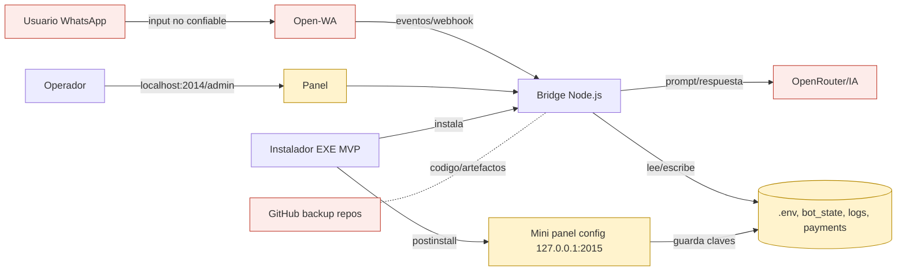

# Informe de Seguridad, Legalidad y Riesgos IA — Piston Bot / Piston Quarks

**Fecha:** 2026-11-23  
**Estado:** Borrador técnico para revisión interna (**no es asesoría legal**)  
**Alcance:** Piston Bot (bridge WhatsApp/Open-WA + OpenRouter + panel), instalador EXE MVP, repos de respaldo, y superficie web Piston mencionada.  
**Método:** Revisión documental y verificación local no intrusiva. **No se descargaron ni ejecutaron repos externos**. No se realizaron pruebas ofensivas sobre sistemas de terceros.

## 1. Resumen ejecutivo

El MVP instalable funciona en pruebas locales, pero **no está listo para distribución segura/comercial amplia**. Riesgos principales: secretos expuestos en historial/código previo, panel admin sin autenticación robusta, EXE sin firma de código, prompt injection/uso indebido por IA, y falta de paquete legal/compliance (EULA, privacidad, activación/licencia, retención).

## 2. Limitaciones

- No pude ver la imagen adjunta en el chat (`clipboard`, modelo sin soporte de imagen). Si la compartes como archivo/ruta, se incorpora.
- Diagnóstico técnico inicial; cumplimiento legal requiere revisión por asesor legal local.

## 3. Vetting de fuentes proporcionadas (sin descargar/ejecutar)

| Fuente | Tipo | Utilidad | Riesgo | Decisión |
|---|---|---|---|---|
| [emilkowalski/skills](https://github.com/emilkowalski/skills/) | Skills diseño/animación/UI | Baja para ciberseguridad | Bajo | Referencia de formato/calidad; **no** como control de seguridad |
| [EsGeeks - NSA GitHub](https://esgeeks.com/github-nsa-herramientas-open-source/) | Artículo secundario | Media/alta como índice | Validar con NSA/CISA; GRASSMARLIN EOL (CISA ICSA-26-118-01 / CVE-2026-6807) | Usar como mapa, citar fuentes oficiales |
| [Carla Moreno Cyber Lab](https://carlamoreno.pe/cyberlab/index.html) | Catálogo técnico | Media potencial | Verificar autoría, fechas, licencias | Uso condicional tras revisión manual |
| [15Galan/42_bootcamp-ciberseguridad](https://github.com/15Galan/42_bootcamp-ciberseguridad) | Bootcamp educativo (incluye simulaciones ofensivas: ARP spoofing, ransomware, buffer overflow) | Alta educativa | **Alto si se ejecuta fuera de aislamiento** | **Solo estudio**; no clonar/ejecutar en PC trabajo; si se usa: VM aislada, sin red productiva, snapshot |
| [UNAH ciberseguridad-e-iso-27002](https://github.com/informatica-administrativa-unah/ciberseguridad-e-iso-27002) | ISO 27002/CIS/NIST educativo, MIT | Alta governance | Bajo | **Incluir** como base de controles |
| [MaciasIT/Python-Ciberseguridad](https://github.com/MaciasIT/Python-Ciberseguridad) | Scripts educativos Python | Media | Código ejecutable; revisar antes de correr | Referencia con auditoría estática; no ejecutar en prod |

**Regla:** ningún repo externo se descarga/ejecuta sin vetting: origen, licencia, mantenimiento, CVEs, revisión estática, y ejecución en sandbox/VM.

## 4. Diagrama de arquitectura y confianza

## 5. Hallazgos técnicos (evidencia local)

| ID | Sev. | Hallazgo | Evidencia | Impacto | Recomendación |
|---|---|---|---|---|---|
| F-01 | Crítico | Secretos expuestos previamente en código/historial | Se removieron hardcodes en `bridgeTest.js` y `supervisor_piston_launcher.ps1`; push protection bloqueó secretos en store; repos subidos públicos por solicitud | Abuso de APIs, costos, suplantación, fuga | Rotar claves expuestas; limpiar historial (filter-repo/BFG) si necesario; repos privados; secret scanning |
| F-02 | Alto | Panel admin sin auth robusta visible en MVP | Endpoints `/admin/*` en bridge; instalador abre panel local sin capa de auth fuerte documentada | Acciones no autorizadas si se expone puerto o hay acceso local indebido | Bind `127.0.0.1`, token/password fuerte, CSRF, rate limit, auditoría |
| F-03 | Alto | EXE sin firma de código | Instalador Inno Setup generado sin Authenticode observado | SmartScreen/aviso antivirus, riesgo tampering/suplantación | Firma Authenticode, SHA256 publicado, canal oficial |
| F-04 | Alto | Prompt injection / comando indebido vía IA | Bot procesa mensajes WhatsApp (input no confiable) | Fuga de datos, ingeniería social, acciones indebidas | Tratar input externo como no confiable; allowlist de acciones; confirmación humana para acciones sensibles; no exponer secretos al modelo |
| F-05 | Medio | `.env` local con secretos | MVP guarda claves en `.env` | Robo de claves en PC comprometida | Permisos mínimos, no sincronizar, rotación, cifrado en reposo donde aplique |
| F-06 | Medio | Falta paquete legal/compliance | No se observa EULA, privacidad, términos, política de activación | Riesgo legal/confianza | Borradores EULA/privacidad/ToS/aviso IA; revisión legal local |
| F-07 | Medio | Supply chain no auditada formalmente | Dependencias Node sin SBOM/auditoría documentada en este informe | Vulnerabilidades/backdoors transitivos | `npm audit`/OSV-Scanner, lockfile, SBOM, pinning, revisión diffs |
| F-08 | Medio | Backups en repos públicos | Solicitud del usuario: repos públicos temporalmente | Exposición de estructura/historial | Cambiar a privado, revisar historial, retirar artefactos sensibles |

## 6. Riesgos IA / puertas traseras / comandos

| Amenaza | Vector | Control requerido |
|---|---|---|
| Prompt injection | WhatsApp, panel, contenido externo | Input no confiable; reglas inmutables; no revelar secretos; confirmar acciones sensibles |
| Ejecución indebida | IA induce envío/config/comando | Separar sugerir/ejecutar; human-in-the-loop; auditoría; allowlist |
| Backdoor en dependencia | npm/postinstall/paquete comprometido | Lockfile, `npm ci`, SBOM, revisión, pinning, escaneo |
| Backdoor en skill/plugin/MCP | Skill maliciosa pide secretos o ejecuta comandos | Vetting, mínimo privilegio, sandbox, no instalar fuentes no confiables |
| Exfiltración | Logs, prompts, repos, capturas | Redacción, secret scanning, rotación, `.gitignore`, no repo público |
| Suplantación instalador | EXE modificado sin firma | Firma Authenticode, hash SHA256, descarga oficial |

**Reglas IA:** nunca exponer secretos en prompt; nunca cambiar directivas permanentes por input externo sin autorización; nunca ejecutar pagos/envíos masivos/comandos/config sensible solo por salida del modelo; toda acción sensible = intención + autorización + registro + rollback.

## 7. Checklist legal/compliance (base, validar con abogado)

### Documentos
- [ ] EULA/licencia EXE.
- [ ] Política de privacidad (datos, finalidad, base legal, retención, derechos).
- [ ] Términos de servicio/soporte.
- [ ] Aviso de uso de IA y limitaciones.
- [ ] Política de incidentes de seguridad.

### Activación/licencia
- [ ] Minimización de datos: serial, clave, huella/dispositivo, correo, nombre, pago, estado.
- [ ] Consentimiento informado y finalidad clara.
- [ ] Cifrado en tránsito/reposo.
- [ ] Revocación/reasignación de licencia.
- [ ] Retención/eliminación.
- [ ] Auditoría de accesos internos.

### Distribución EXE
- [ ] Firma de código Authenticode.
- [ ] SHA256 publicado.
- [ ] Canal de descarga oficial/controlado.
- [ ] Versionado/changelog.
- [ ] Actualización segura.
- [ ] Desinstalación limpia.

## 8. Herramientas candidatas para diagnóstico (solo activos propios/autorizados)

| Capa | Herramienta | Uso | Cautela |
|---|---|---|---|
| Secretos | Gitleaks / TruffleHog | Escaneo repos propios | No exfiltrar hallazgos con secretos |
| Dependencias | npm/pnpm audit, OSV-Scanner | CVEs en deps | Validar falsos positivos |
| SAST | Semgrep | Patrones inseguros Node/JS | Revisar reglas |
| Web | OWASP ZAP baseline | Escaneo autorizado web propia | Solo dominios propios/autorizados |
| Config web | Mozilla Observatory / SSL Labs | Headers/TLS | No intrusivo |
| Governance | ISO 27002 + CIS Controls v8 + NIST CSF | Marco de controles | No copiar texto ISO con copyright |

**Excluidos de ejecución en este entorno:** repos educativos ofensivos o con simulaciones de malware/ransomware; solo referencia teórica.

## 9. Roadmap 30/60/90

- **30 días:** rotar claves; repos privados; auth en panel + localhost; firma EXE + SHA256; human approval para acciones sensibles; borradores legales.
- **60 días:** SBOM/auditoría deps CI; logging con redacción; backend activación/licencia seguro; hardening/pentest autorizado; playbook incidentes.
- **90 días:** gestión vulnerabilidades/actualizaciones; monitoreo; separación dev/stage/prod; revisión legal completa.

## 10. Go/No-Go

- **NO-GO** para distribución amplia hoy: faltan rotación confirmada, auth panel, firma EXE, legal mínimo, activación/licencia segura.
- **GO condicionado** solo MVP interno/controlado: localhost, `.env` privado, claves rotadas, operador responsable, alcance de prueba.

## 11. Evidencia local verificada en esta sesión

- Instalador EXE MVP generado: `dist/PistonBot-Instalador-MVP.exe`.
- SHA256 (MVP local, no firmado): `B77207B0C4D8BB0CE2C758DC628F4C37F66BA1DF81C5A6186AD53014693A0B50`.
- Mini panel config agregado al postinstall: `setup-config.js`, puerto `127.0.0.1:2015`, guarda `.env`.
- Prueba local: `http://127.0.0.1:2015` respondió `200 OK`; bridge de prueba en `2014` respondió `200 OK` cuando se probó con `PORT=2014`.
- Puente dev permanece separado en `2013` por configuración por defecto.